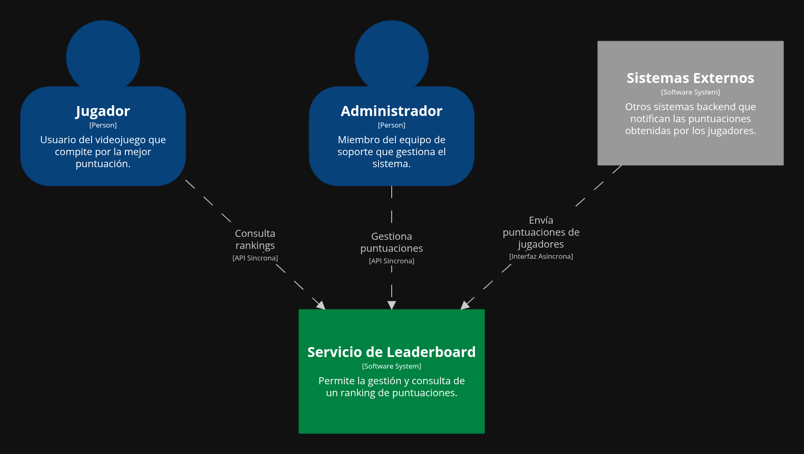

# Leaderboard Service 🏆

Este proyecto es un servicio de backend para gestionar un leaderboard de videojuegos. Su objetivo es registrar las puntuaciones de los jugadores y ofrecer un ranking global.

El desarrollo de este servicio sirve como un ejercicio práctico para aplicar y documentar principios de diseño y arquitectura de software de manera metódica y explícita.

---

## ✨ Arquitectura y Capacidades Principales

La arquitectura general del sistema se describe visualmente a través de los diagramas del **Modelo C4**.

El **[Diagrama de Contexto](docs/diagrams/c4/context_diagram.dsl)** muestra a alto nivel cómo nuestro servicio interactúa con su entorno.

Para un mayor nivel de detalle, el **[Diagrama de Contenedores](docs/diagrams/c4/containers_diagram.dsl)** descompone el servicio en sus principales bloques tecnológicos (la aplicación, la base de datos, etc.).

### Ingesta de Datos (Entradas)

* **Interfaz Asíncrona (Event-Driven):** Diseñada para la comunicación entre sistemas (backend-to-backend).
* **Interfaz Síncrona (API Directa):** Pensada para ser consumida por sistemas de soporte al usuario o herramientas de administración.

### Consulta de Datos (Salidas)

* **Interfaz Síncrona (API de Consulta):** Expone una API para que sistemas externos puedan solicitar el ranking actualizado.

---

## 🎯 Requisitos no Funcionales

Los criterios de calidad y rendimiento que debe cumplir el sistema se definen en el documento de **[Requisitos No Funcionales](docs/NFRs.md)**. Estos requisitos sirven como base para la toma de decisiones técnicas.

---

## 🛠️ Principios de Diseño

El desarrollo se guiará por los siguientes principios arquitectónicos:

* **Arquitectura Hexagonal**
* **Domain-Driven Design (DDD)**
* **Test-Driven Development (TDD) / Behavior-Driven Development (BDD)**

---

## 📐 Decisiones de Arquitectura

Todas las decisiones importantes se documentan a través de **Architecture Decision Records (ADRs)** y se encuentran en el directorio `/docs/ADRs`.

* **[ADR-001: Arquitectura Principal](docs/ADRs/ADR-001_Architecture.md)**
* **[ADR-002: Modelado de Dominio](docs/ADRs/ADR-002_Domain_modeling.md)**
* **[ADR-003: Estrategia de Pruebas](docs/ADRs/ADR-003_Test_strategy.md)**
* **[ADR-004: Lenguaje de Programación](docs/ADRs/ADR-004_Language.md)**
* **[ADR-005: Herramienta de Construcción](docs/ADRs/ADR-005_Build_tool.md)**
* **[ADR-006: Implementación de la Arquitectura](docs/ADRs/ADR-006_Architecture_implementation.md)**
* **[ADR-007: Interfaz Síncrona](docs/ADRs/ADR-007_Synchronous_API.md)**
* **[ADR-008: Interfaz Asíncrona](docs/ADRs/ADR-008_Asynchronous_API.md)**
* **[ADR-009: Persistencia de Datos](docs/ADRs/ADR-009_Data_persistence.md)**
* **[ADR-010: Framework de Desarrollo](docs/ADRs/ADR-010_Development_framework.md)**
* **[ADR-011: Stack de Pruebas](docs/ADRs/ADR-011_Test_stack.md)**
* **[ADR-012: Observabilidad](docs/ADRs/ADR-012_Observability.md)**
* **[ADR-013: Configuración y Secretos](docs/ADRs/ADR-013_Configuration_management_and_secrets.md)**
* **[ADR-014: Migraciones de Base de Datos](docs/ADRs/ADR-014_Database_migration_tool.md)**
* **[ADR-015: Gestión de actualizaciones de dependencias](docs/ADRs/ADR-015_Dependency_upgrade_management.md)**

---

## 🤝 Contribución

Este proyecto tiene una guía de contribución que detalla el flujo de trabajo, las buenas prácticas y cómo proponer cambios significativos. Por favor, consulta el fichero **[CONTRIBUTING.md](CONTRIBUTING.md)** antes de empezar a escribir código.

---

## 🚀 Cómo Empezar

*(Sección a completar más adelante con instrucciones para configurar y ejecutar el proyecto).*